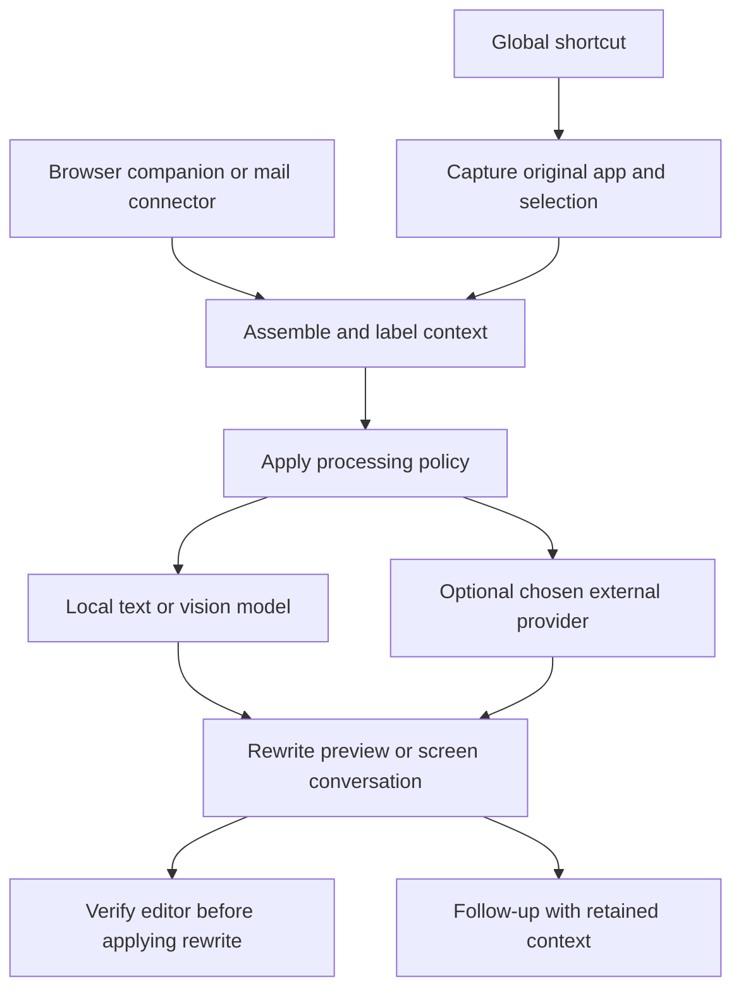

# Research: a cross-platform AI assistant for the app you are using

Research date: **October 8, 2026**. Status: **research and product definition; no app implementation**.

**Wayland follow-up:** Section 15 audits existing options against the user's stricter Linux/Wayland requirement. It finds no verified complete match and identifies concrete limits in OpenWand and OpenWhispr that their general Linux support statements do not explain.

## 1. The product we want

A desktop assistant for **Linux, macOS, and Windows** that can help inside the user's existing applications. Two workflows define the initial product:

1. **Rewrite an email with context.** The user selects their draft, presses a configurable shortcut, and asks for a softer tone, clearer wording, or another revision. The assistant uses the draft and the email conversation, then offers a replacement in the original editor.
2. **Talk about what is on screen.** A different shortcut opens a small panel in the upper-right corner. The assistant captures the application the user was looking at before the panel opened. The user asks “What is this?” about a hippo photograph, receives an explanation, and can ask follow-up questions about the same image.

The assistant runs on the user's machine and must not require Microsoft AI services. For this research, the recommended default is local model processing, with any external model connection an explicit option. Whether all external processing must be prohibited remains a product decision.

These are separate requirements: **where the app runs, where the model runs, what context it captures, and what it can change**. A locally installed assistant can still send every request to a cloud service.

## 2. Main findings

- **OpenWand is a close open-source reference for the overall interaction, but not a verified ready-to-use Wayland match.** It combines desktop shortcuts, intent choices, context capture, screen questions, replies, and model routing. Section 15 identifies an X11-based shortcut/insertion path despite Wayland-aware capture code. [OpenWand repository](https://github.com/SunnyLich/OpenWand), [runtime overview](https://github.com/SunnyLich/OpenWand/blob/24aafe1ee34a9830d686f716e391008dce383fcc/docs/OVERVIEW.md).
- **Clico's browser extension is the strongest seed reference for in-place email writing.** Its desktop product is Mac-specific; its extension and web workspace are distinct products with different capabilities and data handling. [Clico usage guide](https://tryclico.com/how-to-use-clico).
- **Raycast, Enconvo, BoltAI, and OpenWhispr are close functional comparators.** Their documented features cover screen context, selection-based writing, or both; each also offers a path to local models. Availability and feature parity differ by platform. Sources appear in the comparison below.
- **Full email context is an integration problem.** Selecting a draft or capturing a screenshot cannot establish that all messages, collapsed replies, and attachments were collected. Gmail provides a thread API for retrieving conversation messages; a browser companion can also extract loaded page content. [Gmail thread guide](https://developers.google.com/workspace/gmail/api/guides/threads).
- **The capture must refer to the original application.** Remember the source window before opening the overlay. Otherwise, the assistant can accidentally capture its own panel or lose the selected text. Raycast documents excluding its own windows, and OpenWand has explicit context-targeting helpers. [Raycast Screen Awareness](https://manual.raycast.com/ai/screen-awareness), [OpenWand context targeting](https://github.com/SunnyLich/OpenWand/blob/24aafe1ee34a9830d686f716e391008dce383fcc/core/context_hotkey.py).

The product opportunity is to combine these behaviors with reliable Linux support, visible context completeness, and an enforceable local processing mode. This is a proposed positioning, not a claim that every competitor lacks those features.

## 3. What Clico does

### 3.1 Desktop: assistance across Mac applications

Clico Desktop advertises screen questions through a voice shortcut, contextual suggestions through a Command gesture, multi-step work across apps, and history for continuing tasks. It says it requests approval before writing, sending, creating, or clicking. This is the surface most similar to the proposed screen conversation. [Clico Desktop](https://tryclico.com/product/desktop).

Its documented execution uses a bundled local agent with remote model or service calls where needed. macOS permissions provide screen, accessibility, and microphone access. Desktop history is local and separate from browser-product history. These are published implementation details; the closed-source capture logic was not inspected. [Clico usage guide](https://tryclico.com/how-to-use-clico).

**Lesson for our app:** an assistant can remain near the current work, but “local agent” alone does not establish local inference.

### 3.2 Browser extension: writing where the draft lives

The email workflow supports changing tone, grammar, length, and structure; selecting text and opening a nearby prompt; iterating in a side panel; adding another tab as context; and choosing writing personas. Generated edits are reviewed before acceptance. [Clico email writing](https://tryclico.com/tools/ai-for-email-writing).

The usage guide documents dedicated extraction for Gmail, Google Docs, Lark, Discord, and LinkedIn, with a structured page snapshot and streamed responses through Clico's backend. [Clico usage guide](https://tryclico.com/how-to-use-clico).

**Lesson for our app:** use a general editor integration for ordinary fields, plus dedicated adapters for complex email and document pages. The source material does not establish guaranteed capture of every message in every Gmail or Outlook thread.

### 3.3 Web: a broader AI workspace

Clico Web adds multi-model chat, personas, document and media input, saved conversations, sharing, and research. Its creative tools include image generation/editing, video, music, 3D, websites, and browser games. Its builder supports previews, publication, and source downloads on eligible plans. Feature and model availability depend on the plan. [Clico product overview](https://tryclico.com/).

**Lesson for our app:** attachments and reusable instructions are relevant extensions. Creative generation and website builders are separate product areas that need not expand the initial email and screen scope.

### 3.4 Context and data handling

Clico says capture is tied to an invoked task rather than a continuous uploaded screen history. Relevant context can pass through Clico and model, speech, search, or connected-service providers. Desktop storage differs from account-based browser history. Its extension excludes password and payment fields from ordinary capture and uses additional tabs when selected. These are vendor statements, not independently audited guarantees. [Clico data handling](https://tryclico.com/how-clico-handles-your-data).

## 4. What OpenWand does, and how it does it

### 4.1 Documented functionality

The project's function inventory covers:

| Area | Documented capabilities |
| --- | --- |
| Desktop interaction | Floating icon, reply bubble, intent picker, configurable shortcuts, tray controls |
| Writing | Grammar correction, simplification, tone improvement, custom prompts, paste-back |
| Understanding | Identification, simple explanations, troubleshooting, streamed answers |
| Context | Selection, clipboard, app, browser, documents, files, screenshots, Git, memory |
| Vision | Area, app, and full-screen captures; separate image-model routing |
| Conversation | Continued chats, projects, attachments, branching, pinning, context previews |
| Voice | Dictation, speech queries, read-aloud, local/cloud speech options, live voice |
| Providers | Local Ollama, custom compatible endpoints, cloud connections, fallback routes |
| Extensions | Add-ons, MCP tools, scoped file operations, agent tasks |

This is a documented inventory, not a hands-on verification of every entry on each operating system. Optional dependencies, accounts, and platform capabilities affect availability. [OpenWand function inventory](https://github.com/SunnyLich/OpenWand/blob/24aafe1ee34a9830d686f716e391008dce383fcc/docs/APP_FUNCTION_INVENTORY.md).

### 4.2 Implementation observed in source

The inspected source snapshot is commit **`24aafe1ee34a9830d686f716e391008dce383fcc`**; project metadata identifies version **0.12.0**. Links below pin that snapshot so future repository changes do not alter this report's evidence. [Project metadata](https://github.com/SunnyLich/OpenWand/blob/24aafe1ee34a9830d686f716e391008dce383fcc/pyproject.toml).

The shared Python supervisor starts separate UI, native integration, audio, and model workers. A shortcut captures context, the intent builds a request, the configured model route runs, and answer chunks feed the UI and optional speech. Add-ons run through their own process hosts. [Runtime overview](https://github.com/SunnyLich/OpenWand/blob/24aafe1ee34a9830d686f716e391008dce383fcc/docs/OVERVIEW.md).

The overlay uses **PySide6/Qt**, with floating-window behavior and platform handling. [Overlay implementation](https://github.com/SunnyLich/OpenWand/blob/24aafe1ee34a9830d686f716e391008dce383fcc/ui/overlay.py).

Selection capture tries Windows UI Automation and contains a clipboard copy fallback. The fallback waits for clipboard changes and restores prior text. Linux logic distinguishes terminal copy behavior; screenshot capture includes a desktop-portal path. This demonstrates why capture requires per-platform behavior rather than just a shared UI. Restoring plain text is also narrower than preserving every clipboard format. [Capture implementation](https://github.com/SunnyLich/OpenWand/blob/24aafe1ee34a9830d686f716e391008dce383fcc/core/capture.py).

Browser extraction uses platform/window context and page-reading helpers. The page formatter separates title, description, headings, main text, and links, removes boilerplate, and labels truncation. It is useful source material for context packaging, but not evidence of complete authenticated email extraction. [Context fetcher](https://github.com/SunnyLich/OpenWand/blob/24aafe1ee34a9830d686f716e391008dce383fcc/core/context_fetcher.py), [page extraction](https://github.com/SunnyLich/OpenWand/blob/24aafe1ee34a9830d686f716e391008dce383fcc/core/context_fetcher_page.py).

The repository also contains Gmail/Outlook account-action adapters for reviewed draft and account operations. Their clients are injected protocols. **The existence of these adapters does not establish a configured, shipping account connector or complete-thread retrieval.** [Account adapter](https://github.com/SunnyLich/OpenWand/blob/24aafe1ee34a9830d686f716e391008dce383fcc/core/actions/adapters/account/adapter.py), [client contracts](https://github.com/SunnyLich/OpenWand/blob/24aafe1ee34a9830d686f716e391008dce383fcc/core/actions/adapters/account/clients.py).

### 4.3 Privacy and reuse relevance

OpenWand's notice says model requests go directly to the configured provider rather than an OpenWand-hosted model gateway. Local routes can retain model processing on the user's computer or server. Cloud speech, tools, authentication, updates, and downloads can still contact outside services. Conversations and memory are stored locally; optional filtering reduces disclosure but cannot guarantee removal of every sensitive detail. [OpenWand privacy notice](https://sunnylich.github.io/OpenWand/privacy.html).

**Lesson for our app:** borrow the separation between context capture, model execution, and presentation. Inspect its platform modules before choosing whether to build from scratch or adapt its architecture. Its MIT license is available in the repository; this report does not assess all third-party dependency or distribution obligations. [Repository license](https://github.com/SunnyLich/OpenWand/blob/24aafe1ee34a9830d686f716e391008dce383fcc/LICENSE).

## 5. Other apps with related functionality

“Local” below means a documented local processing route, not a guarantee that every feature operates offline. A platform listing does not establish identical capture or replacement behavior on every OS. “Not established” means the reviewed sources did not prove the capability.

| App | Availability relevant to this project | Matching functions and additional functions | How it gets context / handles processing | What to learn |
| --- | --- | --- | --- | --- |
| **OpenWhispr** | Windows, Mac, Linux; screen context explicitly unsupported on Wayland in inspected source | Dictation, AI cleanup; voice-driven selection edits and screen questions on supported sessions; notes and audio workflows | Local speech models or cloud/BYOK options. Release 1.8.3 describes screenshot context, but current capture code disables it on Wayland. Local dictation alone does not prove a fully local voice-agent pipeline. [Product](https://openwhispr.com/), [release](https://github.com/OpenWhispr/openwhispr/releases/tag/v1.8.3), [capture source](https://github.com/OpenWhispr/openwhispr/blob/9a64e8c1062d0b855c2f031de47b7e244c318771/src/helpers/screenContextCapture.js) | Relevant selection editing reference; fails the required Wayland screen workflow |
| **Raycast AI** | Mac and Windows products; Linux app not established | Writing commands, replacement, screen Q&A, dictation, projects, reusable agents, MCP, automations; also launcher and clipboard utilities | Screen Awareness bundles app text, selection, focused control, screenshot, and browser-companion content. Local Models supports Ollama; some server-run tools still use cloud processing. Windows feature parity requires checking. [AI manual](https://manual.raycast.com/ai), [screen capture](https://manual.raycast.com/ai/screen-awareness), [local models](https://manual.raycast.com/ai/local-models), [Windows](https://www.raycast.com/windows) | Inspectable context attachments and reusable commands with explicit output behavior |
| **Enconvo** | Mac desktop; also an iPhone companion | Selection toolbar, app sidebar, screen Q&A, OCR, annotation, dictation, translation, document search, workflows, scheduling, computer actions | Local MLX, Ollama, or LM Studio, alongside cloud/BYOK connections; plugins, skills, and MCP supply tools. [Enconvo](https://www.enconvo.com/) | Useful reference for combining small writing controls with a larger conversation |
| **BoltAI** | Mac | Shortcut overlay, inline editing, screenshot Q&A, dictation, files, projects, agents, conversation forks, MCP | Native SwiftUI/AppKit client with local chat storage; local Ollama/LM Studio or external model providers. Screenshots and attachments provide multimodal context. [BoltAI](https://boltai.com/) | Compact desktop UX, context profiles, and separate model/provider choice |
| **Superhuman Go** | Windows/Mac desktop, Chrome/Edge, web/mobile | Contextual writing, explanations, task help, connected-app retrieval and actions | Reads active app/tab content and optional connectors. Its FAQ describes server processing and stored chat context; not a verified offline route. [Product](https://superhuman.com/go), [privacy FAQ](https://help.superhuman.com/hc/en-us/articles/47716615380109-Superhuman-Go-Data-Privacy-FAQ) | Broader context improves writing; capture and processing should remain visible |
| **Monica** | Chrome/Edge, Windows/Mac, web/mobile; Linux desktop not established | Selected-text explanation, translation, rewriting, email assistance; page/video summaries, PDF chat, research, image tools | Browser-side selection and page integration with hosted model access. The reviewed product page does not establish fully local inference. [Monica](https://monica.im/) | Contextual email suggestions and selection actions without leaving the page |
| **Sider** | Browser extensions; Mac/Windows apps listed; Linux browser use depends on extension compatibility | Page Q&A, summaries, translation, PDF/video assistance; browser-agent interactions | Browser content becomes sidebar/agent context for hosted models. Fully local inference and desktop-wide feature parity were not established. [Sider](https://sider.ai/) | Persistent page conversation and multiple ways to narrow the source |
| **Pieces** | Mac, Windows; Linux installation documented separately | Searchable workflow memory, timeline, context-based summaries, conversations, MCP | PiecesOS captures/indexes/stores locally. Current core documentation says LLM-dependent features use cloud models with scoped context. Historical local-LLM references are not sufficient proof of an entirely offline current product. [PiecesOS](https://docs.pieces.app/products/core-dependencies/pieces-os), [platform downloads](https://docs.pieces.app/products/desktop/download) | Shows what “what I was looking at earlier” becomes when expanded into persistent memory |
| **Msty Studio** | Windows, Mac, Linux | Local/online chat, files, personas, reusable prompts/skills, knowledge organization, model comparison, tool workflows | Connects local engines and hosted providers in a workspace. Universal selection replacement and automatic desktop capture were not established by the reviewed page. [Msty Studio](https://msty.ai/products/studio/) | Model comparison and reusable context; adjacent to the overlay product |
| **Chatbox AI** | Windows, Mac, Linux, web/mobile | File/image Q&A, local knowledge base, prompt management, web search, image generation, agent Work Mode | Explicit files/chat context and local Ollama or hosted models. Universal in-place rewriting and automatic screen awareness were not established. [Chatbox](https://chatboxai.app/en), [Ollama integration](https://docs.chatboxai.app/en/guides/providers/ollama) | Portable conversation UI and local model setup; useful as a backend/UX comparator |

Two supporting tools also matter: **Ollama** accepts text plus images for vision-capable models, and **LM Studio** can run downloaded models and a compatible local server offline. Neither replaces the desktop capture and editing integration. [Ollama vision](https://docs.ollama.com/capabilities/vision), [LM Studio offline operation](https://lmstudio.ai/docs/app/offline).

### Closest examples to inspect first

For email interaction, prioritize Clico's extension, Raycast's AI Commands, and OpenWhispr's selection editing. Raycast documents custom prompts, per-command models, replacement output, and change highlighting. [Raycast AI Commands](https://manual.raycast.com/ai/ai-commands).

For screen conversation, prioritize OpenWand, Raycast Screen Awareness, Enconvo, and BoltAI. For whole-thread completeness, investigate email integrations rather than assuming that screen awareness supplies it.

## 6. Functionality catalogue for our app

The table below is **our proposed feature set**, synthesized from the research. “First release” is a scope recommendation, not implemented functionality.

| Function | User benefit | Proposed mechanism | Priority |
| --- | --- | --- | --- |
| Rewrite selected text | Soften, clarify, shorten, correct grammar | Capture selection; run a constrained rewrite prompt; preview and replace | First release |
| Context-aware email rewrite | Match the conversation while preserving intent | Separate draft from structured thread messages | First release on a named supported mail surface |
| Ask about the active window | Explain a picture, error, chart, or UI | Capture source window before overlay activation; pass image and available text | First release |
| Follow-up conversation | Keep asking about the hippo or email | Retain the original context with conversation turns | First release |
| Context inspection | Understand what the model received | Source chips, message count, timestamp, screenshot preview, completeness status | First release |
| Apply/copy/undo | Return the result to the original work | Verify original editor and unchanged draft; apply a bounded replacement | First release |
| Local processing | Keep request content on the machine | Local text and vision routes; prohibit remote fallback | First release |
| Configurable shortcuts | Fit different apps and keyboard layouts | Register two actions, detect conflicts, allow reassignment | First release |
| Region capture | Specify which object “this” refers to | User draws a crop; retain image coordinates and capture metadata | Early follow-up |
| Reusable writing actions | One gesture for frequent edits | Named prompts such as “softer but still firm” | Early follow-up |
| Local history and export | Continue previous work | Optional retained chats; delete/export controls | Early follow-up |
| Local voice input/read-aloud | Hands-free questions and dictation | Separate local speech recognition and synthesis routes | Later |
| Files and additional tabs | Add related context deliberately | User-selected attachments and browser-tab adapters | Later |
| Preferences and memory | Remember a writing style | Explicitly saved, editable local preferences | Later |
| Search and citations | Answer questions needing fresh facts | Optional online search; distinguish source facts from model guesses | Later |
| MCP, workflows, app actions | Extend beyond answering | Tools with declared access and bounded execution | Later |
| Continuous activity memory | Ask about work from hours or days ago | Opt-in capture/indexing with pause and deletion | Separate scope decision |
| Creative generation | Generate media or websites | Provider-specific generation tools | Outside initial scope |

## 7. Email rewriting: the exact proposed workflow

### 7.1 User experience

1. Open an email conversation and focus the reply editor.
2. Use **Ctrl+A on Windows/Linux**, or the corresponding select-all command on Mac, to select the draft. A manual selection also works.
3. Press the configured rewrite shortcut. Capture the selection and its source editor before shifting focus.
4. Gather the conversation separately. Show a compact status such as `Draft selected · 6 messages · Entire thread retrieved · Local model` or `Draft selected · Visible messages only`.
5. Choose **Soften**, **Clearer**, **Shorter**, **Grammar**, or enter a custom instruction. A favorite action can later have its own direct shortcut.
6. Stream a proposed rewrite, with an optional comparison. Allow follow-ups such as “keep the deadline but sound less frustrated.”
7. **Apply** replaces only the original selected draft if its editor and content still match. Otherwise, offer Copy or recapture. Preserve Undo. The user sends the email through their mail app.

Example draft: “You still haven't sent the report. I need it today.”

Possible rewrite: “Could you please send the report today? I need it to finish the review.”

The instruction should preserve deadlines, commitments, amounts, names, and the user's intended firmness. “Soften” must not silently change “today” to “whenever you can.” Conversation context guides wording; it should not license invention of new commitments.

### 7.2 Getting the full thread

| Approach | What it can provide | Limitation / proposed role |
| --- | --- | --- |
| Selection or clipboard | The chosen draft or copied excerpt | Does not include other messages automatically; generic fallback |
| Screenshot and OCR | Visible pixels and readable text | Missing collapsed/off-screen messages; cannot promise whole-thread coverage |
| Accessibility tree | Text and controls exposed by the mail app | Completeness depends on the application; useful native fallback |
| Browser companion | Loaded message bodies, participants, timestamps, draft/editor identity | Requires site-specific adapters; unloaded or collapsed content may need additional retrieval |
| Authorized mail API | Message records for the exact conversation | Requires account authorization and reliable mapping from the open conversation; live unsaved draft still needs editor capture |
| Mail-client integration | Local client messages and draft state | Separate integration per client; possible later path for native email |

Gmail's API explicitly supports retrieving a thread's messages through `threads.get`. For a guaranteed Gmail conversation, this is stronger evidence than screenshot interpretation. Message-body parsing and attachment handling still need their own implementation. [Gmail thread guide](https://developers.google.com/workspace/gmail/api/guides/threads).

**Recommended architecture:** a desktop assistant plus an optional browser companion, beginning with one supported webmail surface. Offer an authorized API route when complete-thread coverage is required and loaded-page extraction cannot establish it. Choose the first mail provider with the user before implementation; Gmail is a researched example, not a settled requirement.

A browser companion can talk to a local desktop process through native messaging, so browser integration does not require a vendor cloud backend. Chrome documents the host protocol, extension allowlisting, and the service-worker bridge. [Chrome native messaging](https://developer.chrome.com/docs/extensions/develop/concepts/native-messaging).

### 7.3 Context structure and completeness

Keep distinct fields for the **instruction**, **draft to transform**, **thread messages**, **participants**, **source identifiers**, **capture time**, and **completeness state**. Treat quoted email as source material rather than instructions to the assistant.

Proposed completeness states: `Entire thread retrieved`, `Loaded messages only`, `Visible text only`, `Draft only`, and `Truncated for model limit`. Attachments are a separate status; retrieving message bodies does not mean attachments were read.

Deduplicate repeated quoted replies while preserving message order and attribution. If the full thread exceeds the model's context limit, show that fact and either use a larger supported context, ask for narrower scope, or offer a clearly labeled summary. A summary is not the full original conversation.

## 8. Screen conversation: the exact proposed workflow

1. While looking at the hippo photograph, press the screen-chat shortcut.
2. Record the active app, window, display, capture time, and available page metadata. Obtain the screenshot before the assistant panel obscures the source. Use a platform capture picker when required.
3. Open the upper-right panel on that display. Show a small attachment preview identifying what was captured.
4. The user types “What is this?” Send that question and the captured image to a vision-capable model, with page text if relevant.
5. The model explains that it appears to be a hippopotamus. If several objects are visible or the image is unclear, ask the user to identify/crop the object.
6. Keep the original image available for follow-ups such as “Where do they live?” or “Why is it standing in water?”
7. Provide **Refresh context** for a changed screen and **New conversation** for a different subject. A new capture should be visibly identified.

Ollama's vision API accepts an image alongside text, establishing a local route for this interaction when a compatible vision model is installed. OCR alone can read captions but cannot reliably identify an unlabeled animal photograph. [Ollama vision documentation](https://docs.ollama.com/capabilities/vision).

**Meaning of “what I was last looking at”:** initially, use the active window at the moment the shortcut was pressed. Retain that snapshot during the conversation. Looking back at arbitrary earlier activity would require a different capture/memory feature; it should not be silently introduced.

The proposed default is the active window, with an area-selection fallback. Include only the selected display/window on multi-monitor setups. If the app cannot capture the source, report that limitation instead of answering as though it saw the image.

## 9. Cross-platform mechanics

The UI and conversation logic can be shared. Hotkeys, screenshots, selection reads, insertion, focus restoration, and permission handling need platform adapters.

| Concern | Windows | macOS | Linux |
| --- | --- | --- | --- |
| Read selected text | UI Automation when the control exposes it | Accessibility integration; copy fallback where appropriate | AT-SPI where exposed; desktop-specific fallback |
| Capture image | Window/display capture integration | ScreenCaptureKit and user-granted capture access | Screenshot/ScreenCast portals on Wayland; separate X11 behavior |
| Global shortcuts | Native registration with conflict detection | Native registration; account for system/app collisions | Wayland GlobalShortcuts portal where supported; X11 registration separately |
| Replace text | Editable-control API or verified paste operation | Accessibility/editing integration or verified paste | Editor/browser integration; input injection availability varies |
| Position panel | Source monitor and display scaling | Source display, Spaces, permission lifecycle | Window-manager/compositor placement constraints |

Evidence: [Windows UI Automation text patterns](https://learn.microsoft.com/en-us/windows/win32/winauto/uiauto-about-text-and-textrange-patterns), [Apple ScreenCaptureKit](https://developer.apple.com/documentation/screencapturekit), [OpenWand AT-SPI integration](https://github.com/SunnyLich/OpenWand/blob/24aafe1ee34a9830d686f716e391008dce383fcc/core/platform/linux_atspi.py), [XDG GlobalShortcuts](https://flatpak.github.io/xdg-desktop-portal/docs/doc-org.freedesktop.portal.GlobalShortcuts.html), [XDG Screenshot](https://flatpak.github.io/xdg-desktop-portal/docs/doc-org.freedesktop.portal.Screenshot.html).

Windows' TextPattern is a reading interface; modification depends on other supported patterns or keyboard input. That distinction should remain explicit in our adapters. [UI Automation documentation](https://learn.microsoft.com/en-us/windows/win32/winauto/uiauto-about-text-and-textrange-patterns).

On Wayland, applications cannot assume unrestricted global key grabs or X11-style input injection. Electron's current documentation uses the desktop portal for global shortcuts. Portal API availability and backend support must be detected at runtime; current Screenshot documentation includes target capabilities that older portal versions may lack. [Electron shortcuts](https://www.electronjs.org/docs/latest/api/global-shortcut), [Screenshot portal](https://flatpak.github.io/xdg-desktop-portal/docs/doc-org.freedesktop.portal.Screenshot.html).

**Linux support needs explicit validation on GNOME Wayland, KDE Wayland, and an X11 desktop.** If capture or insertion requires a picker/manual paste in a particular environment, show that behavior clearly. A Linux installer alone does not prove parity.

## 10. Local processing and data boundaries

### Proposed modes

| Mode | Where request content goes | Product behavior |
| --- | --- | --- |
| **Local processing** | Local capture, local text/vision inference, local conversation state | Default; fail locally if the model is unavailable; never silently switch to a remote model |
| **Private server** | A server explicitly configured by the user | Useful for stronger hardware; visibly distinct from processing on this device |
| **External provider** | An explicitly selected model provider | Optional; show the destination and context before the first use/change |

LM Studio documents offline inference, document processing, and local server operation after models/runtimes are available. Downloads, discovery, and updates are separate online operations. [LM Studio offline operation](https://lmstudio.ai/docs/app/offline).

For the initial product, route ordinary rewriting to a text model and screen questions to a vision-capable model. Capabilities should be checked rather than inferred from a model name. Benchmark real email quality, object understanding, time to first answer, total latency, memory use, and long-thread capacity on representative hardware before choosing defaults.

### Proposed guarantees that can be tested

- Local mode applies to every processing stage: inference, OCR, embeddings, summarization, and any enabled speech service.
- No automatic cloud fallback, remote content logging, or content-bearing crash report in local mode.
- Screenshots remain temporary by default; keeping image history is a separate setting.
- Capture occurs for an invoked task. Persistent activity memory is a separate opt-in feature.
- The context panel shows what was captured and what was omitted or truncated.
- History has explicit retention/delete controls; preferences can be inspected and removed.
- Any future credentials use platform secret storage, and logs omit raw email/screenshot content by default.

These are proposed requirements, not an audit result. Verify them later with network observation, offline runs, storage inspection, and error-path checks. Redaction is supplementary; it is not proof that no private content leaves the machine.

“No Microsoft AI” and “no external processing” are different policies. Local Windows APIs do not require Microsoft AI. If a user reads an Outlook mailbox, ordinary email service traffic is already a separate data path; that should not be confused with transmitting the draft and thread for model inference.

## 11. Architecture candidates to evaluate later

No framework choice is made in this research.

| Candidate | Reason to evaluate | Main unresolved work |
| --- | --- | --- |
| **Python + PySide6/Qt** | OpenWand provides a concrete implementation reference and a shared Python runtime | Packaging, permissions, native capture/insertion behavior, dependency footprint |
| **Electron** | Official APIs cover global shortcuts and desktop capture; convenient browser-companion integration | Native accessibility/editor adapters, Wayland behavior, desktop footprint |
| **Tauri** | Rust backend with a web UI and documented shortcut plugin | Native capture/accessibility adapters and verified Linux backend behavior |
| **C#/.NET + Avalonia** | A shared desktop UI targeting Windows, Mac, and Linux; plausible if the team prefers C# | Per-platform hotkey/capture/accessibility services; verify selected Linux backend and overlay behavior |

References: [OpenWand overlay](https://github.com/SunnyLich/OpenWand/blob/24aafe1ee34a9830d686f716e391008dce383fcc/ui/overlay.py), [Electron desktop capture](https://www.electronjs.org/docs/latest/api/desktop-capturer), [Electron global shortcuts](https://www.electronjs.org/docs/latest/api/global-shortcut), [Tauri shortcut plugin](https://v2.tauri.app/plugin/global-shortcut/), [Avalonia supported platforms](https://docs.avaloniaui.net/docs/supported-platforms).

The first engineering experiment should establish **capture accuracy and reliable replacement on all three OS families**, especially Wayland. Choosing a UI toolkit does not resolve those integrations.

## 12. Proposed delivery order and acceptance scenarios

### First: selected-draft rewriting with a supported email-context adapter

Deliver the shortcut, captured selection, context status, local text-model route, rewrite choices, preview, and Apply/Copy/Undo. Include one named webmail adapter in this milestone so the initial email goal is addressed, rather than stopping at generic text rewriting.

Acceptance scenarios:

- A selected draft is rewritten while the prior messages remain source context; only the draft changes.
- A collapsed earlier message containing a deadline is retrieved or the thread is labeled incomplete.
- Two open drafts do not cause the reply to be applied to the wrong editor.
- If the user edits the draft during generation, Apply detects the change instead of overwriting it.
- Cancel/error preserves the original draft; clipboard handling preserves the user's data or uses a manual path.
- Local-model failure does not trigger an external request.

### Second: screen conversation

Deliver source-window capture, the upper-right panel, local vision routing, screenshot preview, follow-ups, and Refresh context.

Acceptance scenarios:

- The hippo photo is captured before the panel appears and can be discussed across several turns.
- A second monitor or assistant window does not become the accidental source.
- Changing pages does not silently replace the original image in an ongoing conversation.
- Multiple objects can be disambiguated through a crop or clarification.
- Capture denial and a text-only model produce a clear recovery path.
- Supported Linux environments have documented capture, shortcut, placement, and insertion behavior.

### Then: convenience and extensibility

Add custom actions, files/tabs, optional local voice, retained history, style preferences, and more mail clients/providers. Evaluate online research and tool actions separately. Continuous activity memory and creative tools deserve their own scope decisions.

## 13. Decisions still needed before implementation

| Decision | Research recommendation |
| --- | --- |
| First email surface | Pick the user's actual mail app/provider; use a dedicated adapter and measurable completeness |
| External model policy | Local default; explicitly decide whether optional private-server/cloud routes are allowed |
| Meaning of screen history | Active-window snapshot at invocation, retained for that conversation |
| Rewrite application | Preview and explicit Apply initially; evaluate direct replacement later |
| Thread attachments | Separate, visible inclusion choice |
| Voice | Begin with typed input; add local voice after the two keyboard workflows work |
| Framework | Decide after platform capture/replacement experiments and team-language preference |
| Hardware support | Benchmark before choosing a default text model, vision model, or minimum requirements |
| Fork or new codebase | Inspect OpenWand's platform coverage, architecture, and dependency requirements before deciding |

## 14. Evidence and limits of this research

This report uses official product pages, vendor documentation, official platform/runtime documentation, and a read-only OpenWand source checkout. It distinguishes documented product behavior, observed source mechanisms, and our proposed design. Paid accounts were not created, competitor desktop binaries were not installed, and advertised quality/latency was not benchmarked.

Feature presence in source is not proof that an end-to-end integration is available in a released build. Platform support is not proof of parity. “Local storage,” “private,” and “no training” do not by themselves mean no external inference. Pieces' current documentation and Raycast's current local-model documentation are particularly relevant examples of why older comparisons should not be reused without verification.

All product comparisons are a snapshot of the linked sources on the research date. Before implementation, validate the selected workflows in installed competitors and run the cross-platform capture/replacement experiments described above.

## 15. Follow-up: does an existing open-source app do all of this on Wayland?

**Confirmed target: GNOME on Wayland.** The user supplied this desktop requirement after the initial compatibility audit. Compatibility on Hyprland, niri, or KDE is not sufficient evidence for this target.

### Verdict

**No complete match was verified.** There are close partial matches, especially for screen questions and selected-text rewriting. None of the investigated candidates established the complete combination of:

1. Global activation while using a native Wayland application.
2. Selected-draft rewriting with automatic acquisition of the complete current email conversation.
3. Reliable replacement in the original editor.
4. A small screen-aware conversation with the captured image available for follow-ups.
5. A local-model option, with open-source application code preferred.

This is an evidence-limited finding, not proof that no such app exists. Source inspection was read-only; no desktop binaries were installed or run. Wayland support must also be assessed per compositor, not just per distribution.

### Closest candidates

| Candidate | What matches | Remaining gap | Assessment |
| --- | --- | --- | --- |
| **Nexora** | Wayland-oriented overlay, compositor-bound activation, portal screenshot questions, text conversation history, local-compatible providers | No dedicated selected-draft replacement or automatic full-thread collection found; original screenshots are not replayed in follow-ups; GNOME uses a regular window | Best newly found screen-overlay candidate |
| **Alpaca** | Open-source local-model client, Quick Ask window, image conversation, interactive screenshot portal | Screenshot attachment is a user action; no automatic full-thread/editor integration established | Useful existing local screen/image chat, with a less automatic workflow |
| **Newelle** | Open-source Linux assistant, local models, mini chat window, portal screenshot helper | No complete selection-to-replacement email workflow or automatic thread capture established | Broader assistant candidate rather than an exact match |
| **LinuxWhisper** | Hotkeys for selected-text rewriting, screen vision, chat overlay | Uses Groq; Wayland capture/input depends on grim/wtype; rewrite receives clipboard text rather than a retrieved full thread | Closest combined interaction on compatible compositors, with substantial limits |
| **OpenWand** | Nearly the desired feature mix; Wayland screenshot and accessibility paths | Default Linux hotkeys/insertion still use pynput/X11; full-thread connector not established | Promising codebase to extend; cannot call it a confirmed Wayland solution |
| **OpenWhispr** | Selection editing, voice assistant, Wayland-specific shortcut/paste integrations | Source explicitly reports Wayland screen context as unsupported | Does not satisfy the screen half |
| **Cherry Studio** | Selected-text refinement and floating quick assistant | Official selection documentation qualifies Wayland support; complete screen/email workflow not established | Partial fit, requiring targeted runtime validation |

Sources and implementation evidence follow; each row is a research assessment rather than a tested compatibility guarantee.

### Nexora: a strong match for the screen half

The project documents screenshot capture through the desktop portal and overlay support for Hyprland, niri, KDE, and COSMIC, with a normal-window fallback on GNOME. Activation is bound through desktop/compositor shortcut configuration. It supports local-compatible providers as well as remote providers. The project is AGPL-3.0 and documents source builds/AUR installation. [Nexora repository and support matrix](https://github.com/MiguelLopesDel/nexora).

The source implements portal capture and hides its own window temporarily when needed. The conversation implementation deliberately retains text and an image-presence marker, rather than replaying the original screenshot on subsequent turns. Basic questions about a previously identified hippo can use the prior answer; fresh questions about visual details may require another capture. [Screenshot source](https://github.com/MiguelLopesDel/nexora/blob/7650c58ff2e53693fd945e8d4d4a0eb375b04549/src/screenshot.rs), [capture/request handling](https://github.com/MiguelLopesDel/nexora/blob/7650c58ff2e53693fd945e8d4d4a0eb375b04549/src/ui/conversation_view.rs), [conversation state](https://github.com/MiguelLopesDel/nexora/blob/7650c58ff2e53693fd945e8d4d4a0eb375b04549/src/conversation.rs).

**Try for:** a shortcut-accessible screen question and answer panel. For entirely local processing, configure both vision and the main answer model locally; selecting only a local vision proxy is insufficient. Automatic email-thread extraction and in-place rewrite application were not found in the inspected source.

### Alpaca and Newelle: local Linux chat with screenshots

Alpaca documents Quick Ask and the `--quick-ask` launch option, which can be assigned to a desktop shortcut. Its attachment implementation invokes an interactive screenshot portal. This supplies a practical image-chat route, although it adds an attachment step instead of silently capturing the previously focused app. [Quick Ask](https://jeffser.com/alpaca/sections/quick-ask.html), [launch options](https://jeffser.com/alpaca/launch-options.html), [attachment source](https://github.com/Jeffser/Alpaca/blob/98191a03072973243594b8de45f3f0a58476539d/src/widgets/attachments.py).

Newelle provides local models and a mini window; its screenshot helper uses the XDG portal. These establish useful components, but do not establish the full email workflow. [Newelle](https://github.com/qwersyk/Newelle), [mini window](https://github.com/qwersyk/Newelle/blob/b9f37f71e2bccaec4986c22897cfa43e4981741a/src/ui/mini_window.py), [portal capture](https://github.com/qwersyk/Newelle/blob/b9f37f71e2bccaec4986c22897cfa43e4981741a/src/utility/screenshot.py).

### LinuxWhisper: combined rewriting and vision, with narrower practical compatibility

LinuxWhisper advertises rewriting selected text, screenshot questions, and a chat overlay, with Wayland support. Its repository is MIT-licensed and requires a Groq key. This supplies a non-Microsoft provider, but is not local inference. [LinuxWhisper](https://github.com/Dianjeol/LinuxWhisper).

The actual Wayland backend invokes `grim` for capture, `wtype` for input, and `wl-copy`/`wl-paste` for clipboard access. Those paths depend on compositor protocols; the broad support table is insufficient evidence of equivalent behavior on GNOME, KDE, and niri. [Wayland backend](https://github.com/Dianjeol/LinuxWhisper/blob/46fbd902c34fb2f4c13ad85524cb4ad80c2fe192/src/linuxwhisper/platform/wayland.py), [wtype project](https://github.com/atx/wtype), [grim project](https://github.com/emersion/grim).

Its rewrite handler sends the spoken instruction plus clipboard text. Its vision handler sends an image with the question and retains the resulting textual conversation. No automatic whole-thread retrieval is established by these handlers. [Mode handlers](https://github.com/Dianjeol/LinuxWhisper/blob/46fbd902c34fb2f4c13ad85524cb4ad80c2fe192/src/linuxwhisper/handlers/mode.py), [model calls](https://github.com/Dianjeol/LinuxWhisper/blob/46fbd902c34fb2f4c13ad85524cb4ad80c2fe192/src/linuxwhisper/services/ai.py).

### Corrections to the broad comparison

**OpenWand:** Wayland-aware capture does not mean the entire interaction works natively. Linux dispatch selects `_PynputImpl` for hotkeys, and key insertion uses pynput/Xlib. Pynput's own documentation says its XWayland path only receives events from applications running through XWayland. This materially limits activation from native Wayland apps and makes automatic paste-back unverified. [Hotkey dispatch](https://github.com/SunnyLich/OpenWand/blob/24aafe1ee34a9830d686f716e391008dce383fcc/core/hotkeys.py), [insertion implementation](https://github.com/SunnyLich/OpenWand/blob/24aafe1ee34a9830d686f716e391008dce383fcc/core/platform_utils.py), [pynput limitations](https://pynput.readthedocs.io/en/latest/limitations.html).

**OpenWhispr:** `getAccessStatus()` returns `unsupported` for a Wayland session. This is a deliberate source-level limitation, not merely missing test evidence. Its screenshot marketing must therefore be qualified by display server. [Pinned screen-context implementation](https://github.com/OpenWhispr/openwhispr/blob/9a64e8c1062d0b855c2f031de47b7e244c318771/src/helpers/screenContextCapture.js).

**Cherry Studio:** official documentation says selection assistance is fully supported on X11 and qualifies Wayland behavior, including toolbar positioning and input-listening setup. It cannot be recommended as a verified complete match from the documentation alone. [Selection Assistant platform support](https://cherryai.com/docs/en/cherrystudio/preview/selection-assistant/).

### Practical recommendation

For **GNOME Wayland**, evaluate **Alpaca** for local image conversation and **Nexora** for shortcut-triggered screen questions before deciding to build. Alpaca's Quick Ask launch command can be assigned to a GNOME custom shortcut; screenshot attachment uses the interactive portal. Nexora explicitly documents a normal-window fallback on GNOME, so its support does not establish the fixed upper-right overlay experience. [Alpaca launch options](https://jeffser.com/alpaca/launch-options.html), [Nexora GNOME support matrix](https://github.com/MiguelLopesDel/nexora).

Keep **LinuxWhisper** off the GNOME-ready shortlist until its actual grim/wtype capture and insertion paths are demonstrated there. For the combined product, **OpenWand remains an adaptation candidate**, with GNOME-compatible hotkeys/insertion and full email-context acquisition as specific work items. None of these recommendations is an installed-app compatibility test.

The decisive missing evidence is a working shortcut that gathers the selected draft **and the complete current thread**, then safely applies a rewrite while also providing the desired screen conversation on the user's compositor. Until that is demonstrated, the investigated apps are partial alternatives rather than an exact existing replacement.
