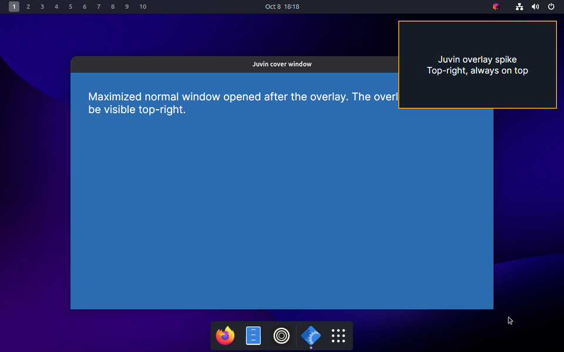
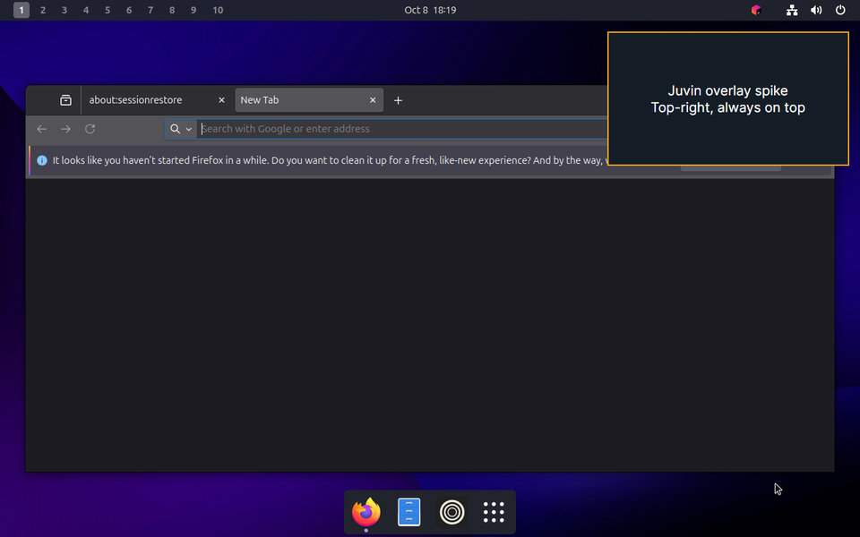
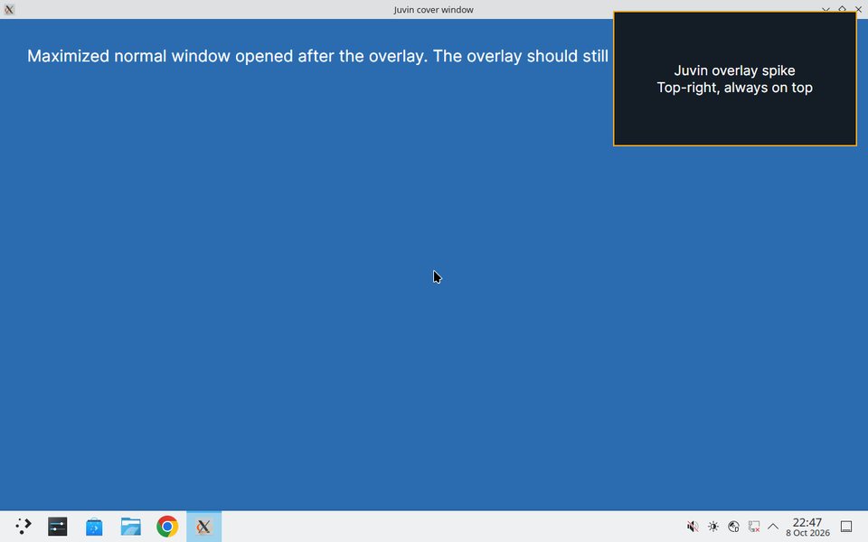
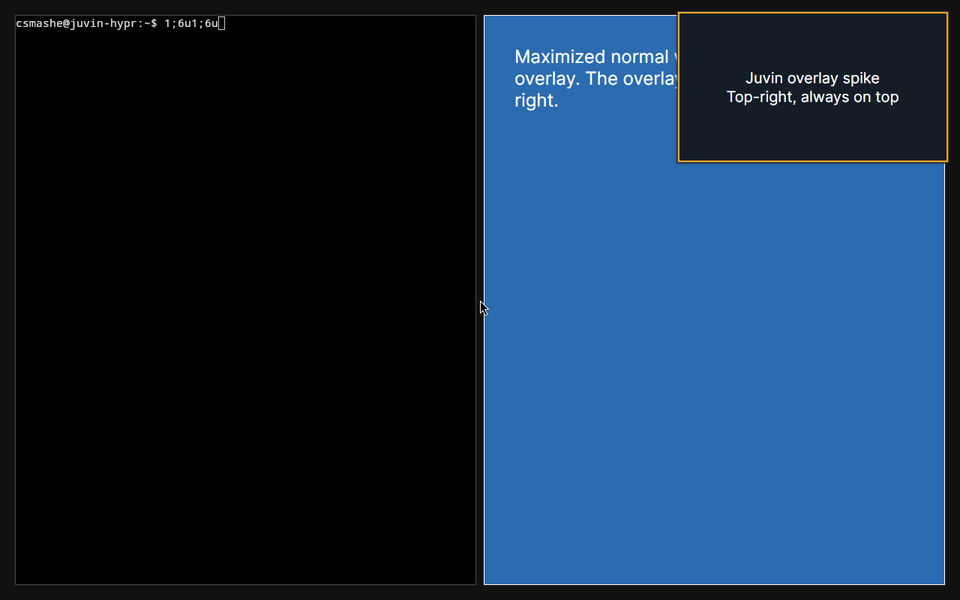

# Spike: Avalonia overlay panel

Date: October 8, 2026. Phase 0 item 4 of `docs/mvp-scope.md`. Result: **go** on GNOME Wayland (Fedora and Ubuntu), KDE Plasma Wayland, Hyprland, and Windows. macOS is deferred (decision of October 8, 2026).

Throwaway code lives in `spikes/overlay-panel/` (see its README to rerun).

## Setup

- Avalonia 12.0.1 window: `WindowDecorations="None"`, `Topmost`, `ShowInTaskbar=false`, `ShowActivated=false`, `CanResize=false`, 360 by 200 logical pixels, placed at the top-right corner of `Screens.Primary.WorkingArea` with a 16 pixel margin, scaled by `RenderScaling`.
- The program then opens a maximized normal window and reports what Avalonia believes about the placement. Placement was confirmed from outside the app: on Fedora through `xdotool` and `xprop` on the XWayland window, on the two VMs with a QEMU console screenshot taken from the Proxmox host.
- Fedora 44, GNOME Shell 50.5 on Wayland, three monitors with the primary in the middle. Ubuntu 25.04 VM, GNOME Shell 48 on Wayland, one 1280 by 800 screen. Windows 11 Pro 23H2 VM, one 1280 by 800 screen, run in the interactive session.

## Results

| Platform | Backend Avalonia picked | Position | Working area honoured | Stays above | Evidence |
| --- | --- | --- | --- | --- | --- |
| Fedora, GNOME Wayland | X11 through XWayland | exact (3464,48 on the middle monitor) | yes, below the 32 px top bar | yes, above the cover window in `_NET_CLIENT_LIST_STACKING`, `_NET_WM_STATE_ABOVE` set | xdotool, xprop |
| Ubuntu, GNOME Wayland | X11 through XWayland | exact (904,47) | yes, below the 31 px top bar | yes, above the cover window and above a focused native Wayland Firefox window | screenshots below |
| Windows 11 | Win32 | exact (904,16) | yes | yes, above a maximized Firefox that was already running | screenshot below |
| Ubuntu 26.04, KDE Plasma 6.6 Wayland | X11 through XWayland | exact (904,16) | yes, panel at the bottom excluded (working area 754 high) | yes, above the maximized cover window; KWin set `_NET_WM_STATE_ABOVE` and `_NET_WM_STATE_STAYS_ON_TOP` | screenshot below |
| Ubuntu 26.04, Hyprland 0.53 | X11 through XWayland | exact (904,16) | no reserved areas on the test config | yes, Hyprland floated it on its own and floating windows render above tiled ones | screenshot below, `hyprctl clients` shows `floating: true`, `pinned: false` |

Ubuntu, overlay above the window opened after it:

Ubuntu, overlay above a focused native Wayland Firefox:

KDE Plasma, overlay above the maximized cover window:

Hyprland with default rules, overlay floated automatically above the tiled cover window:

Windows, overlay above a maximized Firefox:

## Findings

- **Avalonia has no Wayland backend in 12.0.1; `UsePlatformDetect` picks X11 and GNOME runs it under XWayland.** That is what makes positioning possible at all: Wayland clients cannot place themselves, X clients can, and Mutter honours the requested position and the `_NET_WM_STATE_ABOVE` hint for XWayland windows. The reference project relies on the same fact.
- **The above-state crosses the X and Wayland boundary.** Mutter keeps the X overlay above a focused native Wayland window (Firefox), which is the case that matters because the browser the user is working in may be Wayland native.
- **Working area is reported correctly on both GNOME versions** (top bar excluded), so the panel never hides under the bar. On the Windows VM the working area equalled the full screen because the taskbar was hidden behind the maximized browser at capture time; Avalonia reads it from the system either way.
- **Multi-monitor placement works on Fedora**: `Screens.Primary` was the middle monitor and the panel landed on its right edge, not the virtual desktop's right edge. Juvin should place the panel on the screen holding the focused browser window, which needs the active-window position; for the MVP the primary screen is acceptable.
- **Hyprland does not tile the panel.** The panel is an XWayland window with fixed-size hints (`CanResize=false`), which Hyprland floats by default, and floating windows render above the tiled layer. It is not pinned, so it stays on the workspace where it appeared; a `windowrule` for `pin` and `float` keyed on the window class is the one Hyprland-specific setup item, and the reference project already has a Hyprland config writer with the sentinel-block pattern to add it. The reference project itself hides its overlay on Hyprland, Sway, River, and Niri and uses notifications instead; that is fine for a dictation indicator but not for Juvin's interactive panel, and this spike shows the panel can stay.
- **KDE maximized the cover window and kept the panel above it**, with the explicit stays-on-top state. Working area excluded Plasma's bottom panel.
- **The cover window opened by the app was not maximized by Mutter** on Ubuntu (it stayed at its default size) although Avalonia asked for it; irrelevant for Juvin, but it shows that X window state requests are hints under XWayland.
- **Driving the test over SSH:** the window must be created in the interactive session on Windows; on Linux `DISPLAY=:0` plus the Mutter XWayland authority file in `$XDG_RUNTIME_DIR` is enough.

## Consequences for the design

- The rewrite panel is a plain Avalonia `Window` with the properties above, placed from `Screens` and `RenderScaling`. No layer-shell, no portal, no native code for the MVP.
- The panel is created once and its visibility is driven with `Show` and `Hide`, not opacity. The reference project found `Show` after `Hide` unreliable for utility windows on Mutter; checked on GNOME Wayland (XWayland) in Phase 4, a shown-again panel comes back in place, but Mutter drops its above, skip-taskbar, and sticky states on hide, so the app sets all three again after every show.
- On X11, put the window on every workspace with `_NET_WM_DESKTOP` set to `0xFFFFFFFF`, otherwise the panel stays on the workspace it was first mapped on; `_NET_WM_STATE_STICKY` alone only keeps it fixed while a large desktop's viewport scrolls, so the app sends both.
- Keep the X11 backend explicitly configured (rendering mode list with GLX first) when the panel gets a transparent background; this spike used an opaque background.

## Not covered

- macOS: Avalonia's `Topmost` on macOS maps to a floating window level; needs the Mac check with the rest of macOS testing.
- X11 sessions, Sway, River, Niri. X11 is the backend already exercised through XWayland, so a native X11 session is expected to behave the same or better. KDE and Hyprland were added on October 8, 2026 on a second Ubuntu VM.
- Multi-monitor on KDE and Hyprland. (Hyprland pinning and workspace switching were covered in Phase 4: the app pins the panel through `hyprctl dispatch pin` instead of a window rule, verified October 12, 2026.)
- Transparent backgrounds, DPI scaling above 1, a panel that follows the focused browser's monitor, and show/hide cycles.
- A true Wayland backend, should Avalonia ship one; the layer-shell question would return then.
